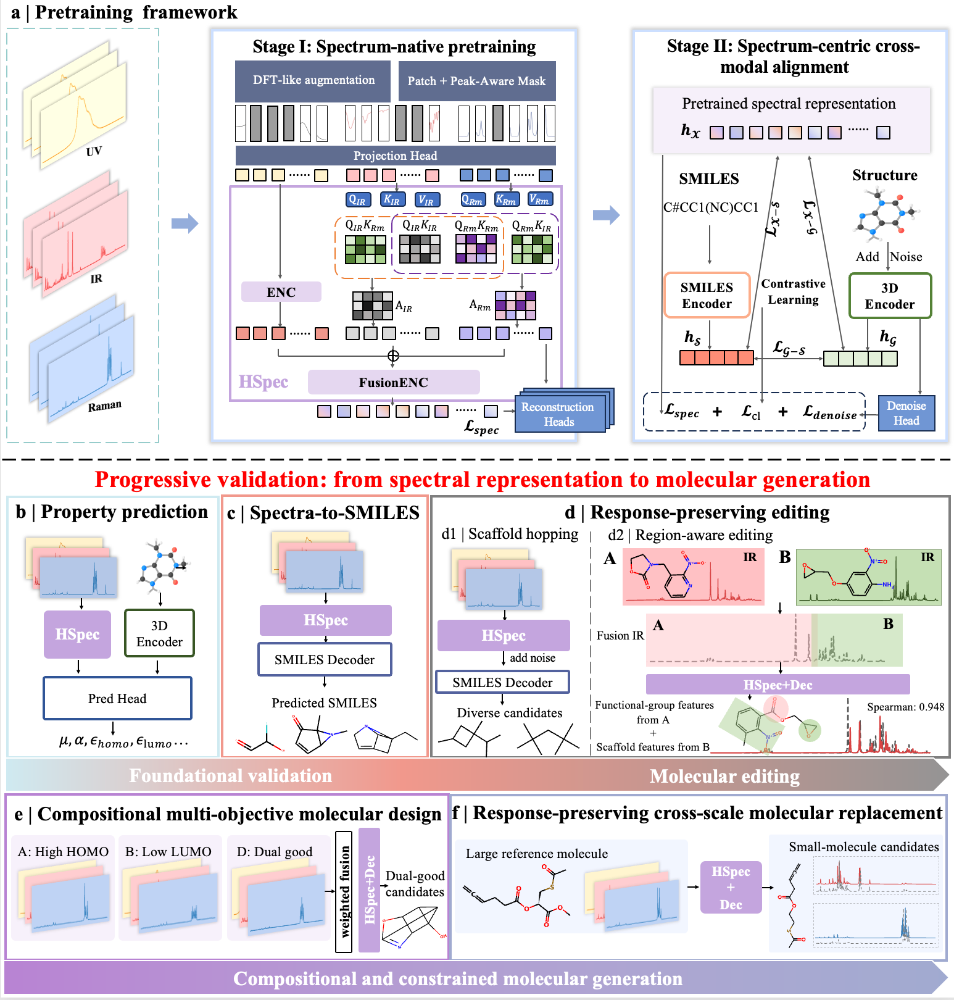

# Spec-S³

Spec-S³ is a spectrum-centric multimodal foundation model for compositional molecular generation.
Through two-stage pretraining, it learns representations of UV–Vis, IR and Raman spectra and aligns them with 3D molecular structures and SMILES.
The learned spectral space supports molecular property prediction and structure inference, while enabling spectral composition for molecular editing and multi-objective generation, as well as response-preserving, size-controlled molecular replacement.



## Requirements

Python 3.11, PyTorch 2.5.1 and CUDA 12.4. Run all commands from this directory.

```bash
conda env create -f environment.yml
conda activate spec-s3
python -m pip install --no-deps -r requirements.txt
python -m pip install -e . --no-deps
```

Original public datasets: [QM9S](https://doi.org/10.6084/m9.figshare.24235333)
and [USTC-FG26](https://huggingface.co/datasets/csllpr/USTC-FG26).
Download the processed datasets and evaluation proxies
from [Hugging Face](https://huggingface.co/datasets/biyunying/spec-s3_datasets).
Place the datasets in `datasets/<dataset>/` and evaluation proxies in
`proxy_models_qm9s/` and `proxy_models_fg26/`.
Download the [pretrained checkpoints](https://huggingface.co/biyunying/spec_s3_checkpoint)
and place them in `checkpoints/`.

## Usage

Settings are in `examples/`; command-line arguments override them.
Downstream training defaults to the supplied pretraining weights. To use your
own weights, add `--init-checkpoint PATH` to the training command.

### Pretraining

```bash
# Stage I: masked spectral reconstruction.
bash scripts/pretrain_stage1.sh

# Stage II: initialize from Stage I and add multimodal objectives.
bash scripts/pretrain_stage2.sh

# Adapt the newly trained Stage II model to QM9S.
STAGE2_CHECKPOINT=experiments/pretrain_stage2/last.ckpt bash scripts/pretrain_qm9s.sh
```

### Task 1: Property prediction

Train the joint spectral–3D model on QM9S, then evaluate the fixed test split.
The example below predicts HOMO using the supplied QM9S-adapted initialization.

```bash
bash scripts/property.sh --dataset-arg homo
python test/evaluation/evaluate.py --task property_prediction \
  --conf examples/property.yaml --checkpoint experiments/property/last.ckpt
```

### Task 2: Spectrum-to-SMILES

Train the cross-attention decoder. This checkpoint is also the warmup for Task 5.

```bash
bash scripts/warmup.sh --decoder crossattn
python test/generate/generate.py --task translation \
  --conf examples/translation.yaml --checkpoint experiments/warmup_crossattn/last.ckpt
python test/evaluation/evaluate.py --task translation \
  --conf examples/translation.yaml --input evaluation_results/translation/candidates.csv \
  --output evaluation_results/translation/metrics
```

### Task 3: Scaffold and IR editing

Train the GPT decoder, generate scaffold edits and evaluate them.
This checkpoint is also the warmup for Task 4.

```bash
bash scripts/warmup.sh --decoder gpt
python test/generate/generate.py --task scaffold_editing \
  --conf examples/editing.yaml --checkpoint experiments/warmup_gpt/last.ckpt
python test/evaluation/evaluate.py --task scaffold_editing \
  --conf examples/editing.yaml --input evaluation_results/editing/candidates.csv \
  --output evaluation_results/editing/metrics
```

Generate IR-editing cases using the supplied region-aware checkpoint; no aggregate evaluation is run.

```bash
python test/generate/generate.py --task ir_editing --conf examples/editing.yaml
```

### Task 4: Multi-objective generation


```bash
bash scripts/multiobjective.sh \
  --checkpoint experiments/warmup_gpt/last.ckpt --objective large_gap --device cuda:0
python test/generate/generate.py --task multiobjective \
  --conf datasets/FG26/task4_generated/large_gap/config.yaml --device cuda:0
python test/evaluation/evaluate.py --task multiobjective \
  --conf datasets/FG26/task4_generated/large_gap/config.yaml \
  --input datasets/FG26/task4_generated/large_gap/generation/candidates.csv \
  --output datasets/FG26/task4_generated/large_gap/evaluation --device cuda:0
```

Replace `large_gap` with `small_gap` for the other objective. Optional
`--homo-threshold` and `--lumo-threshold` set explicit targets; otherwise training-set
quantiles are used. Always use the generated `config.yaml` for that run.

Evaluation defaults to `--property-source proxy`. For independent DFT evaluation:

```bash
# Select Top-50 using the proxy; export molecules and a blank DFT result template.
python test/evaluation/evaluate.py --task multiobjective \
  --conf datasets/FG26/task4_generated/large_gap/config.yaml --property-source dft --topk 50 \
  --input datasets/FG26/task4_generated/large_gap/generation/candidates.csv \
  --output evaluation_results/task4_dft

# Run DFT externally and fill dft_results.csv, then evaluate measured energies.
python test/evaluation/evaluate.py --task multiobjective \
  --conf datasets/FG26/task4_generated/large_gap/config.yaml --property-source dft \
  --dft-results evaluation_results/task4_dft/dft_results.csv --output evaluation_results/task4_dft
```

Both modes report dual-good rate, distinct dual-good scaffolds and new dual-good
scaffolds relative to the disclosed anchors. See the [DFT CSV format](docs/reproduction.md#task-4-dft-csv-format).

### Task 5: Size-controlled generation

Reuse the Task 2 checkpoint; budgets default to 9, 11 and 13 heavy atoms.

```bash
python scripts/budget_data.py \
  --checkpoint experiments/warmup_crossattn/last.ckpt \
  --test-size 100 --small-max 13 --large-min 18 --topk 5 --device cuda:0
bash scripts/budget.sh --conf datasets/FG26/task5_generated/config.yaml --device cuda:0
python test/generate/generate.py --task budget \
  --conf datasets/FG26/task5_generated/config.yaml --device cuda:0
python test/evaluation/evaluate.py --task budget \
  --conf datasets/FG26/task5_generated/config.yaml \
  --input evaluation_results/budget/candidates.csv --output evaluation_results/budget/metrics
```

Spectral scores use available dataset spectra; unseen molecules require separate DFT calculations.

See [reproduction details](docs/reproduction.md) for metric definitions and data conventions.
